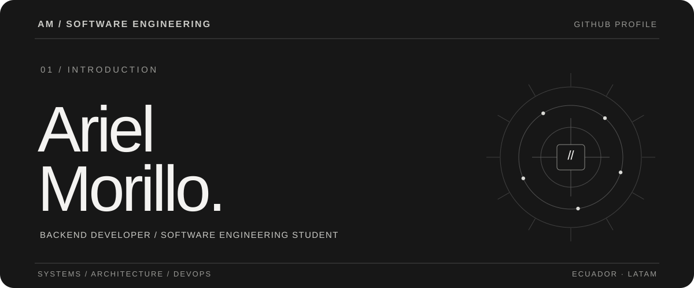

<picture>
  <source media="(max-width: 600px)" srcset="./assets/hero-mobile.svg">
  
</picture>

Software Engineering student in Ecuador. I build **APIs and data-driven applications** with Node.js and TypeScript, with a focus on backend architecture, data integrity and testing.

[Selected work](#selected-work) · [Stack](#stack) · [Contact](#contact)

## Selected work

### [Inventory & POS](https://github.com/arieleMM-dev/inventario-pos-multisucursal)

A multi-branch inventory and sales system. The backend brings together role-based access, PostgreSQL persistence and integration tests for concurrent sales.

**Node.js · TypeScript · Express · Prisma · PostgreSQL · Vitest**

[Explore the backend](https://github.com/arieleMM-dev/inventario-pos-multisucursal/tree/main/backend) · [Read the concurrency test](https://github.com/arieleMM-dev/inventario-pos-multisucursal/blob/main/backend/src/__tests__/sale.concurrency.test.ts)

### [Finca Jirah](https://github.com/arieleMM-dev/sistema-jirah)

Agricultural traceability with offline field capture, built with Next.js and Prisma on SQLite/libSQL.

**TypeScript · Next.js · Prisma · SQLite/libSQL**

## Stack

**Backend** &nbsp; Node.js · TypeScript · Express 
**Data** &nbsp; Prisma · PostgreSQL · SQLite 
**Quality & delivery** &nbsp; Vitest · Docker · CI/CD

## Engineering interests

API design, transactional consistency, automated testing and software architecture. Currently deepening my understanding of distributed systems and delivery pipelines.

## Contact

[LinkedIn](https://www.linkedin.com/in/ariel-morillo-dev) · [Portfolio](https://arielmorillo-dev.vercel.app/) · [GitHub repositories](https://github.com/arieleMM-dev?tab=repositories)
