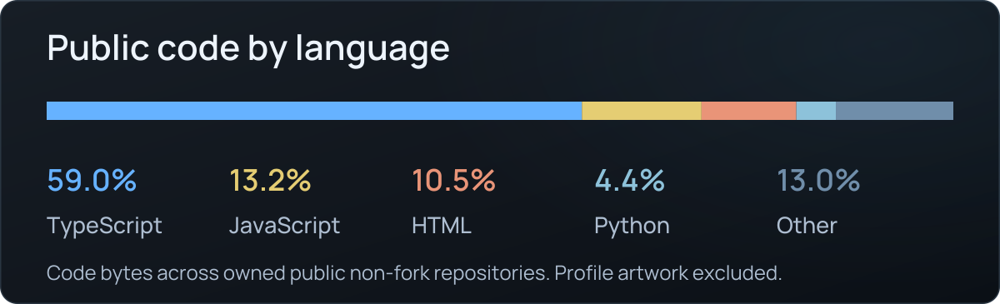
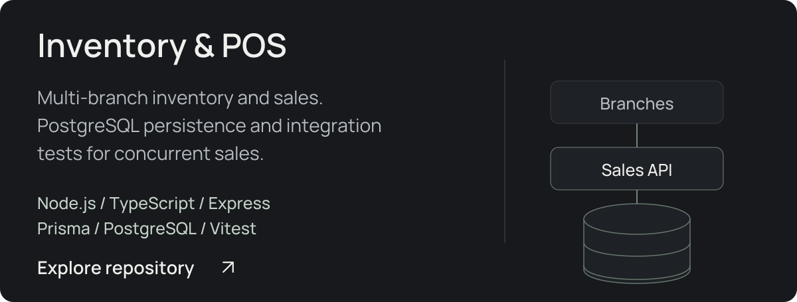

<!-- Generated profile artwork and public activity: design/README.md. -->

<picture>
  <source media="(max-width: 1100px)" srcset="./assets/profile/hero-mobile.svg">
  
</picture>

<picture>
  <source media="(max-width: 1100px)" srcset="./assets/profile/stack-mobile.svg">
  
</picture>

<a href="https://github.com/arieleMM-dev?tab=overview#js-contribution-activity-description">
<picture>
  <source media="(max-width: 1100px)" srcset="./assets/profile/activity-mobile.svg">
  
</picture>
</a>

Explore languages and activity data

<picture>
  <source media="(max-width: 1100px)" srcset="./assets/profile/languages-mobile.svg">
  
</picture>

<a href="./design/activity.json">View public data</a> · <a href="https://github.com/arieleMM-dev?tab=repositories">Browse repositories</a>

<picture>
  <source media="(max-width: 1100px)" srcset="./assets/profile/work-mobile.svg">
  
</picture>

<a href="https://github.com/arieleMM-dev/inventario-pos-multisucursal">
<picture>
  <source media="(max-width: 1100px)" srcset="./assets/profile/inventory-mobile.svg">
  
</picture>
</a>

<a href="https://github.com/arieleMM-dev/sistema-jirah">
<picture>
  <source media="(max-width: 1100px)" srcset="./assets/profile/jirah-mobile.svg">
  
</picture>
</a>

<a href="https://www.linkedin.com/in/ariel-morillo-dev">
<picture>
  <source media="(max-width: 1100px)" srcset="./assets/profile/contact-linkedin-mobile.svg">
  
</picture>
</a>

<a href="https://arielmorillo-dev.vercel.app/">
<picture>
  <source media="(max-width: 1100px)" srcset="./assets/profile/contact-world-mobile.svg">
  
</picture>
</a>

Text version

## About

I'm Ariel Morillo, a Software Engineering student in Ecuador focused on backend development. I build APIs and data-driven applications with Node.js and TypeScript.

## Technologies

Node.js, TypeScript, Express, Prisma, PostgreSQL, Docker, Vitest and CI/CD.

## Public activity

The activity chart is generated from public GitHub data and refreshed daily. Contributions and active days follow GitHub's UTC calendar. The refresh date uses Ecuador time. Private contributions that are not visible publicly are excluded.

Language percentages describe code bytes in owned public non-fork repositories, excluding this profile's generated artwork. They do not measure proficiency.

[View the current data](./design/activity.json) | [Browse repositories](https://github.com/arieleMM-dev?tab=repositories)

## Projects

**[Inventory & POS](https://github.com/arieleMM-dev/inventario-pos-multisucursal)** is a multi-branch inventory and sales system with Node.js APIs backed by PostgreSQL. Its backend uses TypeScript, Express and Prisma.

**[Finca Jirah](https://github.com/arieleMM-dev/sistema-jirah)** is an agricultural traceability application with offline field capture, built with TypeScript, Next.js and Prisma. SQLite/libSQL is used in this project.

## Contact links

[LinkedIn: connect with me](https://www.linkedin.com/in/ariel-morillo-dev) | [Portfolio](https://arielmorillo-dev.vercel.app/)

