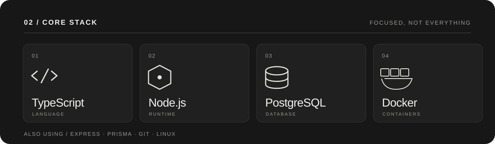
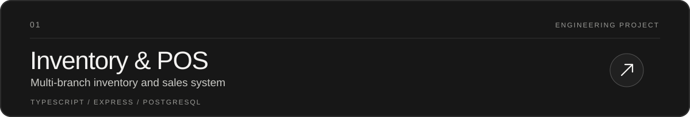
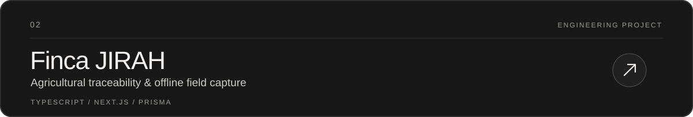
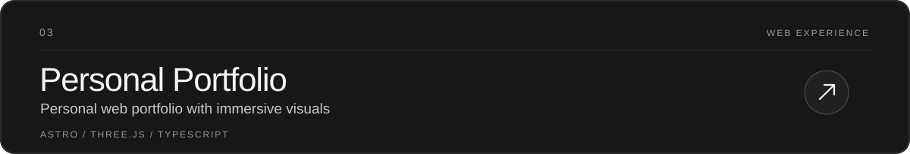

<!--
  ARIEL MORILLO / PROFILE README
  Design: monochrome editorial, self-hosted SVGs, no external widgets.
  Visual source assets live in ./assets/. All project links verified on GitHub.
-->

  

  <a href="#about">About</a> &nbsp; · &nbsp;
  <a href="#technologies">Technologies</a> &nbsp; · &nbsp;
  <a href="#selected-work">Selected work</a> &nbsp; · &nbsp;
  <a href="#contact">Contact</a>

### About

Software Engineering student with a focus on **backend development**, API design and data-driven applications. Interested in **software architecture, distributed systems and DevOps** — building solutions that are reliable, maintainable and useful.

Currently exploring system design, backend architecture and modern deployment workflows.

### Technologies

  

### Selected work

### Contact

  

  <a href="https://github.com/arieleMM-dev">GitHub</a> &nbsp; · &nbsp;
  <a href="https://github.com/arieleMM-dev?tab=repositories">Repositories</a>

