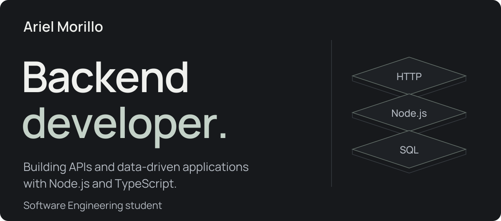
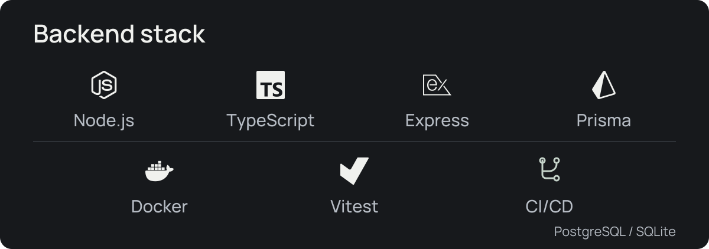
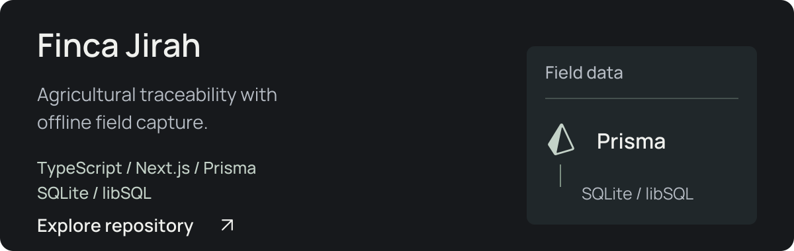

<!-- Profile artwork is generated from design/generate_profile.py. No external image services. -->

<picture>
  <source media="(max-width: 1100px)" srcset="./assets/profile/hero-mobile.svg">
  
</picture>

<picture>
  <source media="(max-width: 1100px)" srcset="./assets/profile/stack-mobile.svg">
  
</picture>

<picture>
  <source media="(max-width: 1100px)" srcset="./assets/profile/work-mobile.svg">
  
</picture>

<a href="https://github.com/arieleMM-dev/inventario-pos-multisucursal">
<picture>
  <source media="(max-width: 1100px)" srcset="./assets/profile/inventory-mobile.svg">
  
</picture>
</a>

<a href="https://github.com/arieleMM-dev/inventario-pos-multisucursal/blob/main/backend/src/__tests__/sale.concurrency.test.ts">
<picture>
  <source media="(max-width: 1100px)" srcset="./assets/profile/test-mobile.svg">
  
</picture>
</a>

<a href="https://github.com/arieleMM-dev/sistema-jirah">
<picture>
  <source media="(max-width: 1100px)" srcset="./assets/profile/jirah-mobile.svg">
  
</picture>
</a>

<a href="https://www.linkedin.com/in/ariel-morillo-dev">
<picture>
  <source media="(max-width: 1100px)" srcset="./assets/profile/contact-linkedin-mobile.svg">
  
</picture>
</a>

<a href="https://arielmorillo-dev.vercel.app/">
<picture>
  <source media="(max-width: 1100px)" srcset="./assets/profile/contact-world-mobile.svg">
  
</picture>
</a>

Text version

## About

I'm Ariel Morillo, a Software Engineering student in Ecuador focused on backend development. I build APIs and data-driven applications with Node.js and TypeScript.

## Technologies

Node.js, TypeScript, Express, Prisma, Docker, Vitest and CI/CD. I also work with PostgreSQL and SQLite/libSQL.

## Projects

**[Inventory & POS](https://github.com/arieleMM-dev/inventario-pos-multisucursal)** is a multi-branch inventory and sales system with PostgreSQL persistence and integration tests for concurrent sales. Its backend uses Node.js, TypeScript, Express and Prisma.

[Read the Vitest concurrency test](https://github.com/arieleMM-dev/inventario-pos-multisucursal/blob/main/backend/src/__tests__/sale.concurrency.test.ts).

**[Finca Jirah](https://github.com/arieleMM-dev/sistema-jirah)** is an agricultural traceability application with offline field capture, built with TypeScript, Next.js and Prisma on SQLite/libSQL.

## Contact links

[LinkedIn](https://www.linkedin.com/in/ariel-morillo-dev) | [Portfolio](https://arielmorillo-dev.vercel.app/)

